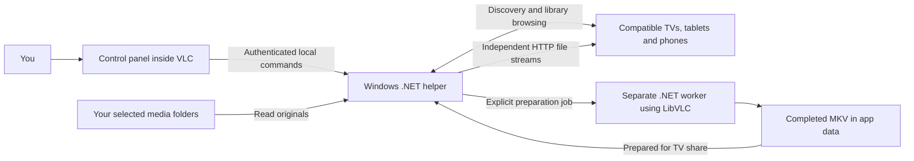

# How Kami-Serv works

Kami-Serv turns selected folders on a Windows PC into a browsable home-network media library. VLC provides the familiar place to manage it and the codecs used to prepare media. A separate .NET helper handles discovery, library browsing, and delivery to playback devices.

You might share a Movies folder and a TV Shows folder, watch one file through Roku Media Player, and open another through VLC on a phone. Each player requests its own data. Its playback position is independent of the other players and of VLC's playlist on the PC.

[Back to the README](../README.md)

## The three parts

### The VLC extension is the control panel

The extension has three pages:

| Page | Purpose |
| --- | --- |
| **Library folders** | Add or remove folders, edit their TV labels and media filters, enable or stop sharing, rescan files, and refresh activity. |
| **Server & playback** | Save the advertised server name/icon, choose audio and subtitle preferences, and check or repair Windows Firewall access. |
| **Prepare for TV** | Select a shared video and prepare a short preview or a full-length MKV, optionally with burned-in subtitles. |

For an external subtitle, select the video, click **Load SRTs for selected video**, then choose the actual filename under **Subtitle source**. The server validates the choice against that video's scanned sidecars; the interface cannot submit an arbitrary subtitle path.

The panel sends authenticated commands to the helper over the PC's loopback interface. Playback devices cannot use these management endpoints over the LAN.

### The helper is the media server

The helper advertises a UPnP MediaServer, answers library browsing requests, and serves indexed media over HTTP. It implements the discovery and media-server pieces needed by the tested clients, including ContentDirectory browsing, ConnectionManager information, basic event subscriptions, and file delivery with byte ranges.

File extensions currently determine MIME types. The server does not yet probe every indexed file to choose a playback strategy for each device.

### The worker prepares media

For a preparation job, the helper launches a separate copy of its own .NET executable in worker mode. That worker loads LibVLC from the selected VLC installation, inspects the file's tracks, and creates the requested MKV.

There is no Python worker in the installed application and no separate FFmpeg executable is used for preparation. The codecs and muxer come from the installed VLC. A separate worker process isolates native codec failures from the server and allows a preparation job to be terminated when the helper shuts down.

## What UPnP and DLNA mean here

On a home network, a compatible player needs a way to find servers, browse their libraries, and obtain media URLs. Kami-Serv supplies those functions through UPnP AV interfaces commonly used by DLNA players.

SSDP provides discovery over UDP port `1900`. The discovered device description points the client to the server's services. When the player browses a folder, ContentDirectory returns its children and media URLs. The player then requests the chosen file over HTTP, normally through TCP port `57642`.

The client receives a file stream and decodes it on its own device. A TV that cannot decode a particular codec may still find and browse that file successfully. Discovery, browsing, decoding, and playback controls are separate parts of compatibility.

Kami-Serv has working evidence from Roku Media Player on a TCL 55S20 and playback confirmation from VLC for Android. It has not been certified by the DLNA organization, and support for other clients requires testing.

## Why several devices can play independently

The server does not keep a single global movie position. It serves a file independently for every HTTP request. A player's requests for later or earlier byte ranges do not change what another player receives.

The TV or phone implements the playback controls. HTTP byte-range support gives it a way to request another part of the file, but the client must understand the container and its timing/index information to seek usefully. Pause, rewind, or fast-forward behavior therefore depends on the player and media as well as the server.

Some tested Roku samples needed a few seconds after startup before their controls became available. Retesting after that delay succeeded. This observation does not establish that MP4 generally needs remuxing.

The default limit is **16 concurrent HTTP requests**, not 16 viewers or 16 encoding jobs. One client may open multiple requests. Four local LibVLC players passed independent playback/control checks; simultaneous playback on multiple physical TVs remains to be verified.

## Original delivery, remuxing, and burn-in

These paths have different costs and purposes:

| Path | What happens | Useful when |
| --- | --- | --- |
| **Original delivery** | The server sends the indexed file as it exists. | The client already supports its container and streams. |
| **MKV remux** | VLC puts the selected existing streams into a new Matroska container without a video re-encode. | A prepared MKV or a particular existing audio selection is useful for that client. |
| **Subtitle burn-in** | VLC re-encodes video as H.264 and draws the chosen embedded captions into the frames. | The client does not display the subtitle format, or permanent visible captions are desired. |

An MKV container alone does not make an unsupported video or audio codec playable. Likewise, selecting Dolby or AAC chooses a track already present in the source; it is not audio conversion.

The present interface performs preparation only when requested. It does not inspect a TV request and silently start a live conversion.

## A preparation job, step by step

1. You choose a video from the shared library and request a two-minute preview or full-file preparation.
2. The helper snapshots the saved playback preferences and creates a separate job directory under its app data.
3. The worker inspects the input through LibVLC. A requested embedded subtitle track must exist before burn-in proceeds. An explicitly selected SRT is first copied read-only from the source into the private job directory and attached to VLC for burn-in instead.
4. VLC writes a new MKV. Burn-in uses H.264 video encoding; ordinary preparation remuxes the selected streams.
5. After VLC completes and flushes the file, the worker inspects the result. A source containing audio or video must retain those stream types in the output.
6. The helper checks that the source and selected sidecar are still shared, moves the completed MKV into its prepared-media directory, and adds that directory as **Prepared for TV**. If an SRT was selected without burn-in, its unchanged copy is placed beside the MKV with the matching output base name before the video is published.
7. You refresh the client library and play the prepared version.

The output inspection catches missing streams; it is not a full frame-by-frame integrity or device-compatibility guarantee. Failed or incomplete jobs are not published as finished prepared videos. Job logs and intermediate output can remain in the application's preparation directory for diagnosis.

One job runs at a time in this alpha. Preferences changed afterward apply to future jobs. Completed prepared files remain available until removed from storage; uninstall deliberately keeps them.

## Audio and subtitle preferences

### Audio

**English Dolby when available** looks for an existing English AC-3 or E-AC-3 track. **English AAC when available** looks for an existing English AAC track. If the preferred kind is unavailable, VLC retains its automatic/default selection. **File default** leaves selection to VLC from the outset.

Language takes priority over merely finding a Dolby track: a foreign-language Dolby track is not preferred simply because it uses that codec. The current preferences do not expose every possible language or commentary-track rule.

Prepared outputs use the selected audio stream. Original-file delivery leaves track availability and switching to the client. A single track in the TV menu can still contain stereo or surround audio; the number of menu entries is not the number of audio channels.

### Subtitles

Burn-in selects an embedded track by its zero-based index. The first subtitle track is `0`; a missing selection produces a preparation error.

Alternatively, select a matching SRT filename. That selection overrides the embedded index. VLC's automatic local sidecar discovery is disabled inside the preparation worker, so a nearby unrelated subtitle is not silently chosen. With burn-in disabled, a selected SRT is copied alongside the finished MKV rather than muxed into it. With burn-in enabled, it becomes part of the video picture.

Placement options include the bottom edge, top edge, or the file's authored position with an offset. For authored positioning, positive offsets move captions up and negative offsets move them down. The edge modes currently have no adjustable safe-area inset.

Plain text subtitles can use font family, size, bold, color, and outline preferences. Bitmap captions already contain their lettering as images, so font controls cannot redraw their characters. Styled ASS subtitles may retain their authored styling. These differences are properties of subtitle rendering, not missing audio/video tracks.

Once captions are burned into a prepared video, a client cannot switch them off as a separate subtitle stream. The source file remains available unchanged.

### Direct SRT delivery

The scan associates same-folder `.srt` files by base name, including language-tagged names such as `Movie.eng.srt`. It chooses the longest matching video base name when filenames overlap: `Movie.Part2.eng.srt` belongs to `Movie.Part2`, rather than `Movie`. A plain same-name subtitle takes first place, then English-tagged files, then the remaining names in alphabetical order. Videos with the same base name in different containers share the same sidecars; give different cuts distinct base names if they need different captions.

Sidecars stay attached to the video entry, so they do not inflate the library with standalone subtitle items. Each video advertises the SRT resources as `text/srt`, along with a primary caption link using Samsung `CaptionInfo`/`CaptionInfoEx` and PacketVideo subtitle attributes. Media responses also include the primary `CaptionInfo.sec` header. These are compatibility mechanisms used by existing players, not a guarantee that every television will offer a subtitle menu. See [VLC's UPnP reader](https://github.com/videolan/vlc/blob/3.0.x/modules/services_discovery/upnp.cpp) and [Jellyfin's DLNA metadata builder](https://github.com/jellyfin/jellyfin-plugin-dlna/blob/master/src/Jellyfin.Plugin.Dlna/Didl/DidlBuilder.cs) for the corresponding client/server conventions.

SRT requests support GET, HEAD and byte ranges through the same delivery path as video, and use the same sharing-enabled, indexed-video, and filesystem reparse checks. A URL is limited to an associated scanned sidecar filename; it is not a general filesystem endpoint. Disabling sharing, removing/filtering out the video, or rescanning after subtitle removal revokes access.

The first implementation accepts nonempty SRTs up to 16 MiB and associates at most 32 per video. It skips hidden/system/reparse entries and unmatched names. It sends or copies the bytes unchanged, so UTF-8 is recommended. It does not yet convert encodings, edit subtitle timing, search/download captions, expose a global language preference, or support external ASS/VTT sidecars. Native playback styling belongs to the client; server style controls apply to burn-in. Network metadata, delivery and actual burn-in have automated checks; physical Roku/Android subtitle selection remains to test.

## What the activity window tells you

**ACTIVE** rows describe requests that are currently open. A small request can finish before the next refresh, and a player can buffer a large amount of video while making no new request.

**RECENT** rows retain the latest finished request for each client/file combination for ten minutes, capped at 50 entries. They include the client address, filename, method, HTTP status, range, and completion/interruption result. This history stays in memory and clears when the helper restarts.

Click **Refresh activity** or **Refresh status** to update the list. It does not refresh automatically. Neither an active row nor a recent row establishes whether the TV is presently playing, paused, or finished.

## Startup, shutdown, and installation

The installed extension starts or attaches the helper when opened. Closing the panel leaves sharing running while its VLC process remains alive. If several VLC instances attach, the helper tracks each process identity and stops when the last attached instance exits, including a VLC crash.

At shutdown, active transfers are cancelled and preparation workers are stopped. Playback can continue briefly on a client that already buffered content. The standalone development server has a separate console lifecycle and is stopped with Ctrl+C.

The current installer is per-user:

| Location | Purpose |
| --- | --- |
| `%APPDATA%\LibraryShare` | Installed helper, scripts, extension source, runtime configuration, and data. |
| `%APPDATA%\vlc\lua\extensions` | Extension and its generated local control module. |
| `%APPDATA%\LibraryShare\build` | Saved library/playback preferences, control credential, logs, preparation jobs, and prepared media. |

The **LibraryShare** paths and the **Share Library** interface name are retained from the working alpha; Kami-Serv is the project name. A future branding pass can change visible names while preserving installed users' data.

Fresh installs receive their own server ID and control credential, with sharing off and no folders selected. Upgrades retain saved settings. Setup does not ship the developer's library configuration or media. Uninstall removes owned program files, extension files, shortcuts, registration and firewall rules, while keeping configuration and prepared media. It leaves unrelated files alone.

## Firewall access and trust

Firewall setup opens only the helper's media/browsing port and SSDP discovery port, scoped to Private networks and the local subnet. Repair verifies the application's own rules and replaces mismatched rules rather than accumulating duplicates. Rule names identify the installation, and uninstall targets those owned rules.

The elevated firewall command is separate from normal VLC and server operation. Cancelling setup permission leaves the application installed. If owned firewall rules need removal during uninstall, cancelling that permission stops removal so it can be retried.

The status check reports whether the expected rules are present and calls out an absent Private network, a disabled Private-profile firewall, or policy restrictions. This does not certify overall reachability: another firewall, guest-network isolation, a VPN, or network policy can still affect communication. The application does not reclassify networks or turn the firewall on or off.

Only selected, indexed media is served. Scanning skips hidden/system entries and junctions/symbolic links. Removing a shared folder or disabling sharing revokes its delivery and cancels associated active transfers. These protections do not create a per-person access-control system: use an enabled share on a network whose reachable devices you trust.

## What comes next

The foundation is original-file delivery, VLC-powered preparation, and independent client requests. The next work is broader real-device testing and installation validation, consistent Kami-Serv branding, and signing.

Automatic format decisions would require reliable device profiles and richer stream metadata. Live transcoding adds another challenge: a player's request for a different time must be translated into an independent conversion session with appropriate timestamps, seek behavior, caching, and resource limits. That work is separate from the file preparation that already works.

Hardware encoding, more conversion presets, additional languages and subtitle layout options, background scanning, HDR handling, and an optional FFmpeg fallback are possible extensions. They are not promised capabilities of this alpha.

For build instructions, tests, and reporting guidance, return to the [README](../README.md).
